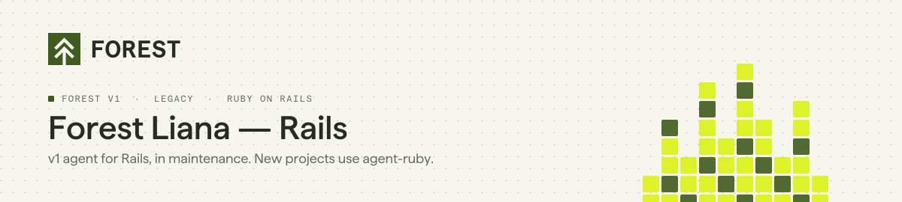
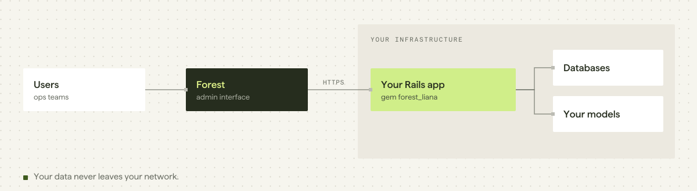

<p align="center">
  <picture>
    <source media="(prefers-color-scheme: dark)" srcset="./assets/header-forest-rails-dark.svg">
    
  </picture>
</p>

<p align="center">
  <a href="https://rubygems.org/gems/forest_liana"></a>
  <a href="https://github.com/ForestAdmin/forest-rails/actions/workflows/build.yml"></a>
  <a href="./LICENSE"></a>
</p>

> [!IMPORTANT]
> **This is the Forest v1 agent for Rails, in maintenance mode.** It receives fixes but no new features.
> **Starting a new project?** Use [agent-ruby](https://github.com/ForestAdmin/agent-ruby), the current Ruby agent.
> **Already on forest_liana?** Follow the [v1 to v2 migration guide](https://docs.forest.app/guides/migration/from-v1/overview).

## Quick start

```ruby
# Gemfile
gem 'forest_liana'
```

```bash
bundle install
bundle exec rails generate forest_liana:install <FOREST_ENV_SECRET>
```

The generator mounts the engine on `/forest`, writes `config/secrets.yml` and creates the initializer:

```ruby
# config/initializers/forest_liana.rb
ForestLiana.env_secret  = Rails.application.secrets.forest_env_secret
ForestLiana.auth_secret = Rails.application.secrets.forest_auth_secret
```

Full guide: [docs.forest.app/legacy/ruby-agent/how-tos/setup/install](https://docs.forest.app/legacy/ruby-agent/how-tos/setup/install)

## Requirements

| | |
|---|---|
| Rails | `>= 6.1.7.9` |
| Ruby | tested in CI on 3.3 |

## How it works

<picture>
  <source media="(prefers-color-scheme: dark)" srcset="./assets/arch-forest-rails-dark.svg">
  
</picture>

The gem runs **inside your Rails application**. It introspects your ActiveRecord models and generates the admin API on your servers. The Forest interface calls this API: your data does not go through Forest.

## Documentation

| | |
|---|---|
| Install | https://docs.forest.app/legacy/ruby-agent/how-tos/setup/install |
| v1 reference guide | https://docs.forest.app/legacy/ruby-agent/reference-guide/models/overview |
| Upgrade notes | https://docs.forest.app/legacy/ruby-agent/how-tos/maintain/upgrade-notes-rails/upgrade-to-v9 |
| Agents overview | https://docs.forest.app/legacy/agents-overview |
| Migrating to v2 | https://docs.forest.app/guides/migration/from-v1/overview |

## Contributing

Bug fixes are welcome; new features go to [agent-ruby](https://github.com/ForestAdmin/agent-ruby). See [CONTRIBUTING.md](./CONTRIBUTING.md) for setup, tests and commit conventions.

```bash
RAILS_ENV=test bundle exec rake --trace db:migrate test; bundle exec rspec
```

## License

Apache 2.0. See [LICENSE](./LICENSE).
